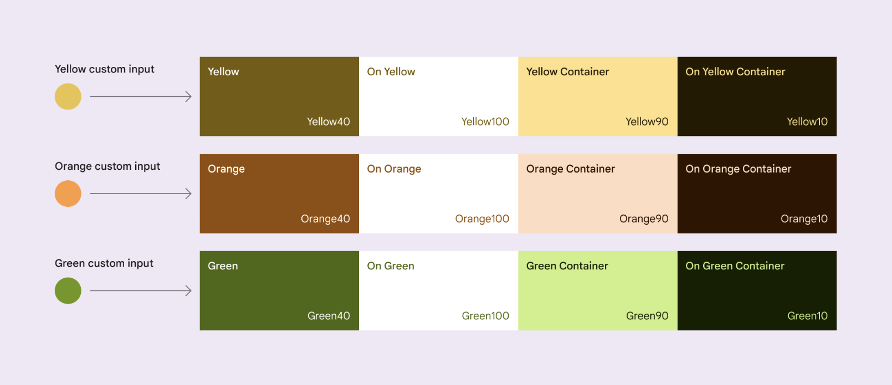

import DynamicColorTheme from '@docs/components/DynamicColorTheme.tsx';

# Theming

:::note
To observe changes related to switching between light and dark mode in the app, ensure that the <i>"Override force-dark"</i> feature in the <i>"developer options"</i> settings on your Android device is <b>not overridden</b>.
:::

## Applying a theme to the whole app

To support custom themes, paper exports a `PaperProvider` component. You need to wrap your root component with the provider to be able to support themes:

```js
import * as React from 'react';
import { PaperProvider } from 'react-native-paper';
import App from './src/App';

export default function Main() {
  return (
    <PaperProvider>
      <App />
    </PaperProvider>
  );
}
```

By default React Native Paper will apply the [Material You theme (MD3)](https://github.com/callstack/react-native-paper/blob/main/src/theme/schemes/LightTheme.tsx) if no `theme` prop is passed to the `PaperProvider`.

## Accessing theme properties

Use the built-in `useTheme()` hook to get access to the theme's variables:

```js
import * as React from 'react';
import { View } from 'react-native';
import { useTheme } from 'react-native-paper';

export default function PaymentScreen() {
  const theme = useTheme();

  return <View style={{ backgroundColor: theme.colors.primary }} />;
}
```

You can also use the `withTheme()` HOC exported from the library. If you wrap your component with the HOC, you'll receive the theme as a prop:

```js
import * as React from 'react';
import { View } from 'react-native';
import { withTheme } from 'react-native-paper';

function PaymentScreen({ theme }) {
  return <View style={{ backgroundColor: theme.colors.primary }} />;
}

export default withTheme(PaymentScreen);
```

## Theme properties

You can change the theme prop dynamically and all the components will automatically update to reflect the new theme.

A theme usually contains the following properties:

- `dark` (`boolean`): whether this is a dark theme or light theme.
- `shapes` (`object`): corner radii of components, under `corner`, from `extraSmall` (4) to `extraExtraLarge` (48). Each component uses one of them, e.g. `Card` uses `medium`. `Button` is a full pill by default; with `shape="square"` it uses the role of its `size`, `medium` at the default `small` size.
- `colors` (`object`): various colors used throughout different elements.

  > The primary key color is used to derive roles for key components across the UI, such as the FAB, prominent buttons, active states, as well as the tint of elevated surfaces.
  - `primary`
  - `onPrimary`
  - `primaryContainer`
  - `onPrimaryContainer`

  > The secondary key color is used for less prominent components in the UI such as filter chips, while expanding the opportunity for color expression.
  - `secondary`
  - `onSecondary`
  - `secondaryContainer`
  - `onSecondaryContainer`

  > The tertiary key color is used to derive the roles of contrasting accents that can be used to balance primary and secondary colors or bring heightened attention to an element.

  > The tertiary color role is left for teams to use at their discretion and is intended to support broader color expression in products.
  - `tertiary`
  - `onTertiary`
  - `tertiaryContainer`
  - `onTertiaryContainer`

  > The neutral key color is used to derive the roles of surface and background, as well as high emphasis text and icons.
  - `background`
  - `onBackground`
  - `surface`
  - `onSurface`

  > The neutral variant key color is used to derive medium emphasis text and icons, surface variants, and component outlines.
  - `surfaceVariant`
  - `onSurfaceVariant`
  - `outline`

  > In addition to the accent and neutral key color, the color system includes a semantic color role for error
  - `error`
  - `onError`
  - `errorContainer`
  - `onErrorContainer`

  > Surfaces at elevation levels 1-5 use neutral surface tones, such as app bars. Menus and banners use the `surfaceContainer` and `surfaceContainerLow` roles instead. The addition of a grade from 0-5 introduces tonal variation to the surface baseline.
  - `elevation` (`object`)
    - `level0` - transparent
    - `level1` - 5% opacity
    - `level2` - 8% opacity
    - `level3` - 11% opacity
    - `level4` - 12% opacity
    - `level5` - 14% opacity

  > Colors for disabled state
  - `surfaceDisabled`
  - `onSurfaceDisabled`

  > These additional role mappings exist in a scheme and are mapped to components where needed.
  - `shadow`
  - `inverseOnSurface`
  - `inverseSurface`
  - `inversePrimary`
  - `backdrop`

- `fonts` (`object`): various fonts styling properties under the text variant key used in component.
  - [`variant` e.g. `labelMedium`] (`object`):
    - `fontFamily`
    - `letterSpacing`
    - `fontWeight`
    - `lineHeight`
    - `fontSize`

When creating a custom theme, you only need to provide the properties you change. `PaperProvider` merges your theme deeply with the default one, so a nested object such as `shapes` or `motion` keeps every key you leave out.

Paper merges a custom theme onto `DarkTheme` when it sets `dark: true`, and onto `LightTheme` otherwise. The examples on this page still spread `LightTheme` or `DarkTheme`: that sets `dark`, and in TypeScript it gives the theme object the full `Theme` shape. Without TypeScript, nested spreads such as `...LightTheme.colors` are optional.

## Reduce motion

`PaperProvider` takes a `reduceMotion` prop, typed `ReduceMotionPreference`, that turns Paper's animations on or off:

- `'auto'` (default): follows the reduce motion setting of the device, read with React Native's [AccessibilityInfo API](https://reactnative.dev/docs/accessibilityinfo).
- `'on'`: turns Paper's animations off.
- `'off'`: keeps Paper's animations on, even when the device setting is on.

It works the same whether or not you pass a custom `theme`. With `'auto'`, Paper starts from the setting the device had when the app launched and follows every change after that.

When reduce motion is on, Paper's components skip their animations. A few still move: the `ActivityIndicator` rotation, the indeterminate `ProgressBar` and the `TouchableRipple` ripple on web. The `TextInput` label and active indicator follow only the device setting: they don't read the `reduceMotion` prop.

To turn Paper's animations off in tests and screenshots, whatever the device setting, pass `reduceMotion="on"`:

```js
import * as React from 'react';
import { PaperProvider } from 'react-native-paper';
import App from './src/App';

export default function Main() {
  return (
    <PaperProvider reduceMotion="on">
      <App />
    </PaperProvider>
  );
}
```

To follow the same preference in your own components, use the `useReduceMotion()` hook. It returns `true` when reduce motion is on. Reanimated's animations follow the device setting on their own too, so give them `ReduceMotion.Never` to leave the choice to the hook:

```js
import * as React from 'react';
import { useReduceMotion } from 'react-native-paper';
import Animated, { ReduceMotion, SlideInDown } from 'react-native-reanimated';

const slideIn = SlideInDown.reduceMotion(ReduceMotion.Never);

export default function Toast({ children }) {
  const reduceMotion = useReduceMotion();

  return (
    <Animated.View entering={reduceMotion ? undefined : slideIn}>
      {children}
    </Animated.View>
  );
}
```

## Extending the theme

Keeping your own properties in the theme is fully supported by our library:

```js
import * as React from 'react';
import { LightTheme, PaperProvider } from 'react-native-paper';
import App from './src/App';

const theme = {
  ...LightTheme,
  // Specify custom property
  myOwnProperty: true,
  // Specify custom property in nested object
  colors: {
    ...LightTheme.colors,
    myOwnColor: '#BADA55',
  },
};

export default function Main() {
  return (
    <PaperProvider theme={theme}>
      <App />
    </PaperProvider>
  );
}
```

## Creating dynamic theme colors

Dynamic Color Themes allows for generating two color schemes lightScheme and darkScheme, based on the provided source color.
Created schemes are following the Material Design 3 color system and covering colors structure from the Paper theme. User may generate these schemes using the following tool:

<DynamicColorTheme />

<br />

Passed source color into the util is translated into tones to automatically provide the range of tones that map to color roles.



_Source: [Material You Color System](https://m3.material.io/styles/color/the-color-system/custom-colors)_

### Using schemes

Once we have copied the color schemes from the generated JSON above, we can use by passing it to the colors in `theme` object as below:

```jsx
import * as React from 'react';
import { LightTheme, PaperProvider } from 'react-native-paper';
import App from './src/App';

const theme = {
  ...LightTheme,
  colors: yourGeneratedLightOrDarkScheme.colors, // Copy it from the color codes scheme and then use it here
};

export default function Main() {
  return (
    <PaperProvider theme={theme}>
      <App />
    </PaperProvider>
  );
}
```

### Sync dynamic colors with system colors

React Native Paper provides built-in support for Android dynamic colors through `DynamicLightTheme` and `DynamicDarkTheme`. These themes use React Native's `PlatformColor` API to map all Material Design 3 color roles to Android system colors, so any changes the user makes to their system palette are automatically reflected in the app.

:::info
Dynamic colors require Android 12 (API 31+). On older Android versions and all other platforms, these themes fall back to the default `LightTheme` / `DarkTheme`.
:::

```tsx
import { useColorScheme } from 'react-native';
import {
  DynamicDarkTheme,
  DynamicLightTheme,
  PaperProvider,
} from 'react-native-paper';
import App from './src/App';

export default function Main() {
  const isDarkMode = useColorScheme() === 'dark';

  return (
    <PaperProvider theme={isDarkMode ? DynamicDarkTheme : DynamicLightTheme}>
      <App />
    </PaperProvider>
  );
}
```

## Adapting React Navigation theme

The `adaptNavigationTheme` function takes an existing React Navigation theme and returns a React Navigation theme using the colors from Material Design 3. This theme can be passed to `NavigationContainer` so that React Navigation's UI elements have the same color scheme as Paper.

```ts
adaptNavigationTheme(themes);
```

:::info
For users of `react-navigation` version `7.0.0` and above, `adaptNavigationTheme` overrides the **fonts** from the navigation theme as follows:

```ts
fonts: {
  regular: {
    fontFamily: materialTheme.fonts.bodyMedium.fontFamily,
    fontWeight: materialTheme.fonts.bodyMedium.fontWeight,
    letterSpacing: materialTheme.fonts.bodyMedium.letterSpacing,
  },
  medium: {
    fontFamily: materialTheme.fonts.titleMedium.fontFamily,
    fontWeight: materialTheme.fonts.titleMedium.fontWeight,
    letterSpacing: materialTheme.fonts.titleMedium.letterSpacing,
  },
  bold: {
    fontFamily: materialTheme.fonts.headlineSmall.fontFamily,
    fontWeight: materialTheme.fonts.headlineSmall.fontWeight,
    letterSpacing: materialTheme.fonts.headlineSmall.letterSpacing,
  },
  heavy: {
    fontFamily: materialTheme.fonts.headlineLarge.fontFamily,
    fontWeight: materialTheme.fonts.headlineLarge.fontWeight,
    letterSpacing: materialTheme.fonts.headlineLarge.letterSpacing,
  },
}
```

:::

<b>Parameters:</b>

| NAME   | TYPE   |
| ------ | ------ |
| themes | object |

Valid `themes` keys are:

- `reactNavigationLight` () - React Navigation compliant light theme.
- `reactNavigationDark` () - React Navigation compliant dark theme.
- `materialLight` () - React Native Paper compliant light theme.
- `materialDark` () - React Native Paper compliant dark theme.

```ts
// App.tsx
import { NavigationContainer, DefaultTheme } from '@react-navigation/native';
import { createNativeStackNavigator } from '@react-navigation/native-stack';
import {
  PaperProvider,
  LightTheme as PaperLightTheme,
  adaptNavigationTheme,
} from 'react-native-paper';

const Stack = createNativeStackNavigator();

const { LightTheme: NavigationLightTheme } = adaptNavigationTheme({
  reactNavigationLight: DefaultTheme,
});

export default function App() {
  return (
    <PaperProvider theme={PaperLightTheme}>
      <NavigationContainer theme={NavigationLightTheme}>
        <Stack.Navigator initialRouteName="Home">
          <Stack.Screen name="Home" component={HomeScreen} />
          <Stack.Screen name="Details" component={DetailsScreen} />
        </Stack.Navigator>
      </NavigationContainer>
    </PaperProvider>
  );
}
```

## TypeScript

By default, TypeScript works well whenever you change the value of the built-in theme's properties. It gets more complicated when you want to extend the theme's properties or change their types. In order to fully support TypeScript, you will need to follow the guide that fits your use-case most accurately:

There are two supported ways of overriding the theme:

1. <b>Simple built-in theme overrides</b> - when you only customize the values
   and the whole theme schema remains the same
2. <b>Advanced theme overrides</b> - when you <i>add new properties</i> or
   <i>change the built-in schema shape</i>

:::caution
TypeScript support for `withTheme` is currently limited to <b>Material You (MD3)</b> theme only.

<i>
  We are planning to provide a better support of handling custom theme overrides
  in future releases.
</i>
:::

### Simple built-in theme overrides

You can provide a `theme` prop with a theme object with the same properties as the default theme:

```js
import * as React from 'react';
import { LightTheme, PaperProvider } from 'react-native-paper';
import App from './src/App';

const theme = {
  ...LightTheme, // or DarkTheme
  shapes: {
    corner: {
      largeIncreased: 10,
    },
  },
  colors: {
    primary: '#3498db',
    secondary: '#f1c40f',
    tertiary: '#a1b2c3',
  },
};

export default function Main() {
  return (
    <PaperProvider theme={theme}>
      <App />
    </PaperProvider>
  );
}
```

`Theme` requires every key, so it doesn't fit a partial theme kept in a variable. Type the variable with `ProviderProps['theme']`, the type that the `theme` props of `PaperProvider`, `ThemeProvider` and Paper's components take:

```tsx
import * as React from 'react';
import { PaperProvider, type ProviderProps } from 'react-native-paper';
import App from './src/App';

const theme: ProviderProps['theme'] = {
  colors: {
    primary: 'tomato',
  },
};

export default function Main() {
  return (
    <PaperProvider theme={theme}>
      <App />
    </PaperProvider>
  );
}
```

The type includes `undefined`. If the variable must always hold a theme, type it with `NonNullable<ProviderProps['theme']>`.

### Advanced theme overrides

If you need to modify the built-in theme schema by adding a new property or changing its type, you need to follow these steps:

1. Pass your theme overrides to the PaperProvider component

```ts
import * as React from 'react';
import { LightTheme, PaperProvider } from 'react-native-paper';
import App from './src/App';

const theme = {
  ...LightTheme,

  // Specify a custom property
  custom: 'property',

  // Specify a custom property in nested object
  colors: {
    ...LightTheme.colors,
    brandPrimary: '#fefefe',
    brandSecondary: 'red',
  },
};

export default function Main() {
  return (
    <PaperProvider theme={theme}>
      <App />
    </PaperProvider>
  );
}
```

2. Create a typed `useAppTheme()` hook in your project

```ts
import * as React from 'react';
import { LightTheme, PaperProvider, useTheme } from 'react-native-paper';
import App from './src/App';

const theme = {
  ...LightTheme,

  // Specify a custom property
  custom: 'property',

  // Specify a custom property in nested object
  colors: {
    ...LightTheme.colors,
    brandPrimary: '#fefefe',
    brandSecondary: 'red',
  },
};

export type AppTheme = typeof theme;

export const useAppTheme = () => useTheme<AppTheme>();

export default function Main() {
  return (
    <PaperProvider theme={theme}>
      <App />
    </PaperProvider>
  );
}
```

3. Start using the `useAppTheme()` hook across your components in the whole app

```ts
import * as React from 'react';
import { View } from 'react-native';
import { useAppTheme } from './App';

export default function HomeScreen() {
  const {
    colors: { brandPrimary },
  } = useAppTheme();

  return <View style={{ backgroundColor: brandPrimary }}>...</View>;
}
```

## Material Design 3

React Native Paper ships with Material Design 3 (Material You) only. Customize the default experience by extending `LightTheme` or `DarkTheme` (see [Extending the theme](#extending-the-theme) and [Advanced theme overrides](#advanced-theme-overrides)).

## Applying a theme to part of the app

To change the theme of every component in one part of your app, wrap that part in `ThemeProvider`. Like a component's `theme` prop, its `theme` is merged deeply onto the theme above it, so pass only the keys you change:

```js
import * as React from 'react';
import { Button, ThemeProvider } from 'react-native-paper';

export default function CheckoutActions() {
  return (
    <ThemeProvider theme={{ colors: { primary: 'tomato' } }}>
      <Button>Pay</Button>
      <Button mode="outlined">Cancel</Button>
    </ThemeProvider>
  );
}
```

Unlike `PaperProvider`, `ThemeProvider` doesn't choose between `LightTheme` and `DarkTheme` from `dark`. To show part of the app in the dark theme, pass `DarkTheme` itself.

## Applying a theme to a paper component

If you want to change the theme for a certain component from the library, you can directly pass the `theme` prop to the component. The theme passed as the prop is merged with the theme from the `PaperProvider`:

```js
import * as React from 'react';
import { Button } from 'react-native-paper';

export default function ButtonExample() {
  return (
    <Button
      shape="square"
      theme={{ shapes: { corner: { medium: 15 } } }}
    >
      Press me
    </Button>
  );
}
```

## Customizing all instances of a component

Sometimes you want to style a component in a different way everywhere, but don't want to change the properties in the theme, so that other components are not affected. For example, say you want to change the font for all your buttons, but don't want to change `theme.fonts.labelLarge` because it affects other components.

We don't have an API to do this, because you can already do it with components:

```js
import * as React from 'react';
import { Button } from 'react-native-paper';

export default function FancyButton(props) {
  return (
    <Button
      theme={{ fonts: { labelLarge: { letterSpacing: 1 } } }}
      {...props}
    />
  );
}
```

Now you can use your `FancyButton` component everywhere instead of using `Button` from Paper.

## Dark Theme

Since 3.0 we adapt dark theme to follow [Material design guidelines](https://material.io/design/color/dark-theme.html). <br/>
In contrast to light theme, dark theme by default uses `surface` colour instead of `primary` on large components like `Appbar` or `BottomNavigation`.<br/>
The dark theme adds a white overlay with opacity depending on elevation of surfaces. It uses it for the better accentuation of surface elevation. Using only shadow is highly imperceptible on dark surfaces.

If you don't use a custom theme, Paper will automatically change between the default theme and the default dark theme, depending on device settings.

`PaperProvider` follows the device setting only when it gets no `theme`. With a `theme`, it uses `DarkTheme` only when that theme sets `dark: true`, so a theme that only changes colors, such as `theme={{ colors: { primary: '#8E24AA' } }}`, stays light in dark mode. A nested `PaperProvider` with such a theme stays light inside a dark app too, because it doesn't read the theme above it. To follow the device setting with a custom theme, pick `LightTheme` or `DarkTheme` with React Native's [`useColorScheme()`](https://reactnative.dev/docs/usecolorscheme) and spread your colors over it:

```tsx
import * as React from 'react';
import { useColorScheme } from 'react-native';
import { DarkTheme, LightTheme, PaperProvider } from 'react-native-paper';
import App from './src/App';

export default function Main() {
  const base = useColorScheme() === 'dark' ? DarkTheme : LightTheme;
  const theme = { ...base, colors: { ...base.colors, primary: '#8E24AA' } };

  return (
    <PaperProvider theme={theme}>
      <App />
    </PaperProvider>
  );
}
```

## Gotchas

The `PaperProvider` exposes the theme to the components via [React's context API](https://reactjs.org/docs/context.html), which means that the component must be in the same tree as the `PaperProvider`. Some React Native components will render a different tree such as a `Modal`, in which case the components inside the `Modal` won't be able to access the theme. The work around is to get the theme using the `withTheme` HOC and pass it down to the components as props, or expose it again with the exported `ThemeProvider` component.

The `Modal` component from the library already handles this edge case, so you won't need to do anything.
